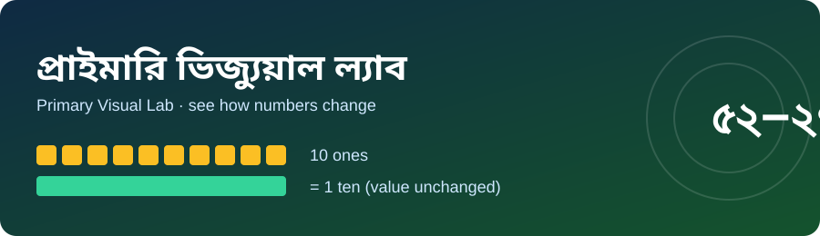

<div align="center">





[](https://nextjs.org)
[](https://www.typescriptlang.org)
[](https://www.mongodb.com/atlas)
[](https://vercel.com)
[](#-bilingual)
[](TEST_PLAN.md)
[](#-free-to-run)

**Teacher-led visual maths lessons for primary school.**
Input → one calculation → a visible change → *why it changed* → next step.

</div>


## 🎬 The idea in one picture

```text
  ৫২ − ২৭          ones: 2 < 7  → cannot take 7 yet
    │
    ▼
  exchange 1 ten ──► 10 ones      value stays 52 ✔
    │
    ▼
  ones: 12 − 7 = 5 ; tens: 4 − 2 = 2
    │
    ▼
  answer ২৫  (objects and written method agree)
```

The engine checks that **the total value never changes during an exchange** across the whole 0–999 range (see `tests/subtraction.test.ts`).

## 🧭 Status (honest)

| Phase | What | State |
|:--:|---|:--:|
| 0 | Inspect, plan, docs | ✅ |
| 1 | Exact maths engine + tests | ✅ engine · ⬜ UI |
| 2–10 | Catalogue, DB, auth, review, workflow, moderation, deploy | ⬜ see [MASTER_PLAN](MASTER_PLAN.md) |

The first lesson is **demonstration content**, not claimed as official curriculum alignment.

## 🌐 Bilingual
Bangla is the default; English is one switch away. Bangla text uses **Kalpurush**. Numerals follow the interface language (০–৯ / 0–9) and learners may type either. See the font licence caveat in [LIMITATIONS](LIMITATIONS.md).

## 💸 Free to run
Vercel Hobby + MongoDB Atlas M0 + GitHub. **Secrets live only in Vercel Environment Variables**; the repo contains an empty `.env.example`. Never commit `.env*`.

## 🚀 Run the tests
```bash
npm install
npm test
```

## 🗂 Docs
[MASTER_PLAN](MASTER_PLAN.md) · [TEST_PLAN](TEST_PLAN.md) · [LIMITATIONS](LIMITATIONS.md) · [ASSET_PROMPTS](ASSET_PROMPTS.md) (logo / favicon / banner prompts for other AIs)


